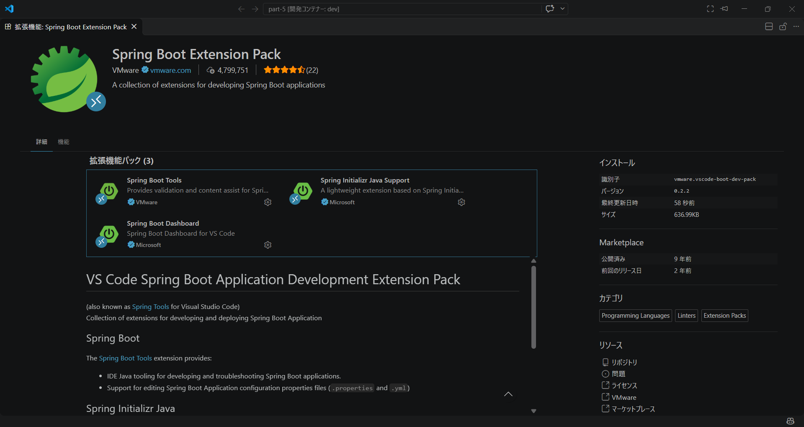
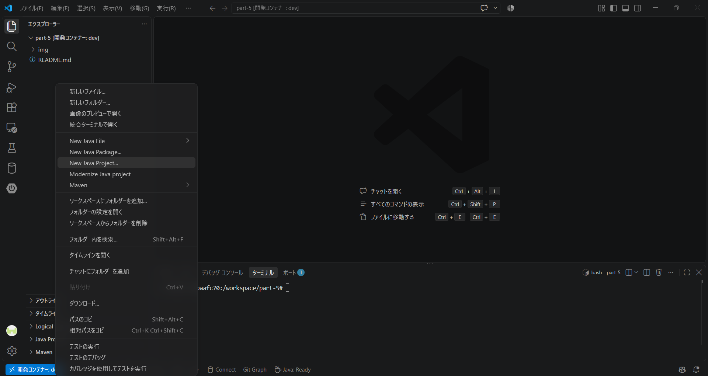
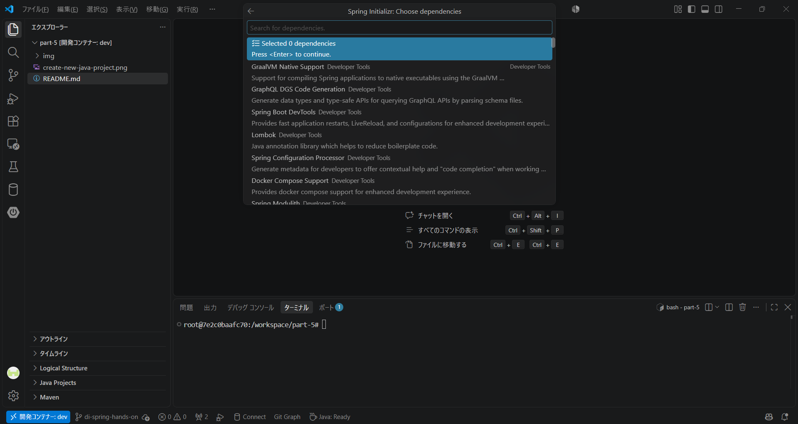
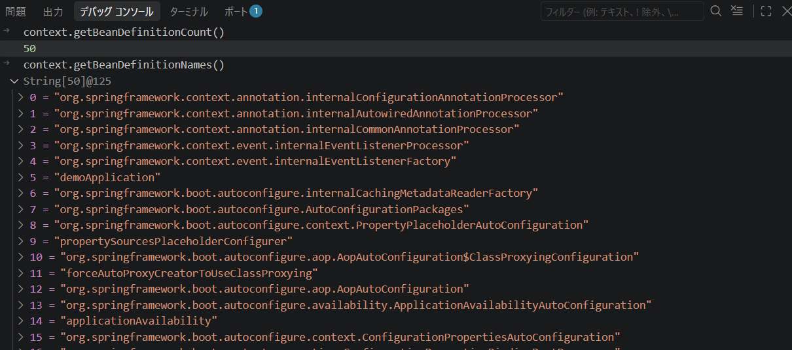

# Spring Bootプロジェクトの作成とSpring BootのDIコンテナの仕組み

このドキュメントでは、Spring Bootプロジェクトの作成方法と、Spring BootのDI（依存性注入）コンテナの仕組みについて説明します。

## Spring Bootプロジェクトの作成

Visual Studio Codeを使用してSpring Bootプロジェクトを作成する手順を以下に示します。

1. 拡張機能「Spring Boot Extension Pack」をインストールします(CodeSpace環境であれば、既にインストール済みです)。


2. 画面左側のエクスプローラーの空白部分で右クリックをして、「New Java Project」を選択します。


3. 「Select the project type」で「Spring Boot」を選択します。

4. 続いて表示される「Select Project Type」で「Maven Project」を選択します。

5. 「Specify Spring Boot version」で使用するSpring Bootのバージョンを選択します(SNAPSHOTではない、安定版の最新バージョンが推奨です)。

6. 「Specify project language」で「Java」を選択します。

7. Group IDとArtifact ID、Package Nameの入力が求められるので、それぞれ適切な値を入力します(特にこだわりがなければデフォルトのままで問題ありません)。

8. 「Specify packageing type」で「Jar」を選択します。

9. 「Specify Java version」で使用するJavaのバージョンを選択します(CodeSpace環境であれば、Java 25を選択してください)。

10. 次に「Search for dependencies」でプロジェクトに必要な依存関係を選択します。ここで必要な依存関係を追加して進みますが、今回のプロジェクト作成では、依存関係を追加せずに、「Selecters 0 Dependencies」を選択して進めます。


11. 最後に、作成先のディレクトリの指定が求められるので、適切なディレクトリを選択してプロジェクトを作成してください(CodeSpace環境であれば、デフォルトの値を選択してください)。入力後、「Generate into this folder」を選択してプロジェクトを生成します。

12. 作成されるSpring Bootのプロジェクトは、開いているVSCode環境より1段深いディレクトリに生成されます。7で選択したArtifact IDがディレクトリ名として使用されます。今回は、作業の都合上、Artifact IDの名前のフォルダから中身を切り取って、開いているVSCode環境のルートディレクトリに配置してください。

13. ディレクトリの変更に伴い、Javaの読み込み設定を変える必要があるので、下側中央左の「Java :Ready」の部分をクリックし、「Clean Workspace Cache」を選択してください。右下に確認のポップアップが表示される場合は、「Reload and delete」を選択してください。

## Spring BootプロジェクトのDIコンテナの確認

SpringBootプロジェクトでDIコンテナの起動を確認するには、`DemoApplication`クラス(選択したArtifact IDによりクラス名が異なる場合があります)の`main`メソッドを実行します。このとき、メインメソッドを以下のように追記し、`System.out.println`の行にブレークポイントを置いて、デバッグコンソールを使う方法がおすすめです。デフォルトでDIコンテナに登録済みのBeanが多数存在していますが、カスタムで定義したBeanを追加すると、追加したBeanも含めて確認することができます。

```java
package com.example.demo;

import org.springframework.boot.SpringApplication;
import org.springframework.boot.autoconfigure.SpringBootApplication;
import org.springframework.context.ConfigurableApplicationContext;

@SpringBootApplication
public class DemoApplication {

	public static void main(String[] args) {
		ConfigurableApplicationContext context = SpringApplication.run(DemoApplication.class, args);
		System.out.println("Spring Boot DIコンテナの起動が完了しました: " + context);
	}

}
```

デバッグコンソールで実行してほしい内容は以下の通りです。

1. DIコンテナに登録されているBeanの数を確認します。
```text
context.getBeanDefinitionCount()
```

2. DIコンテナに登録されているBeanの名前を確認します。
```text
context.getBeanDefinitionNames()
```

### デバッグコンソールでの確認結果の例

